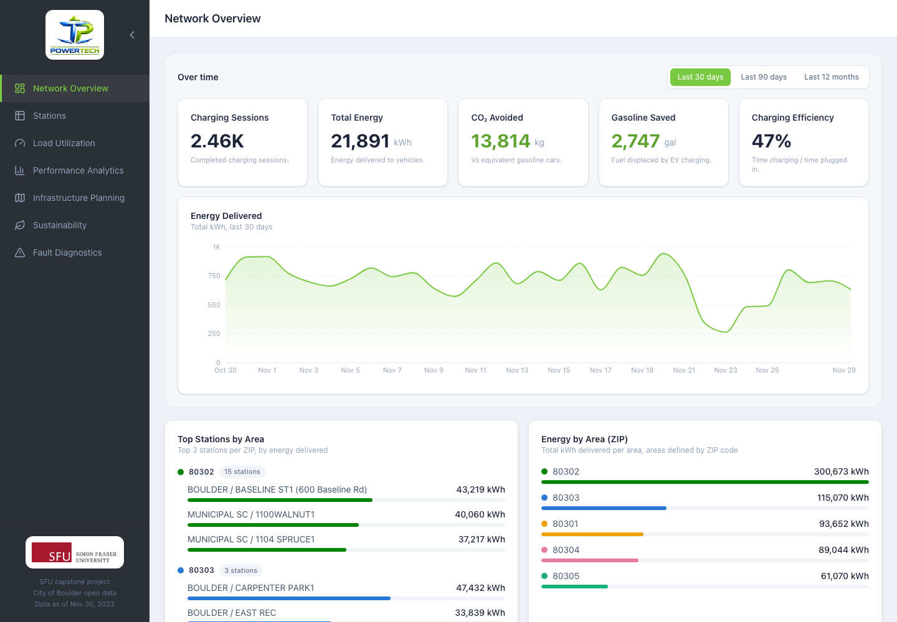
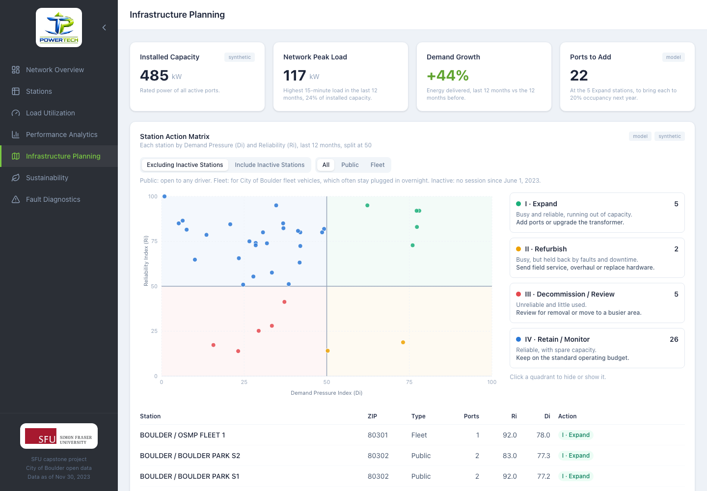
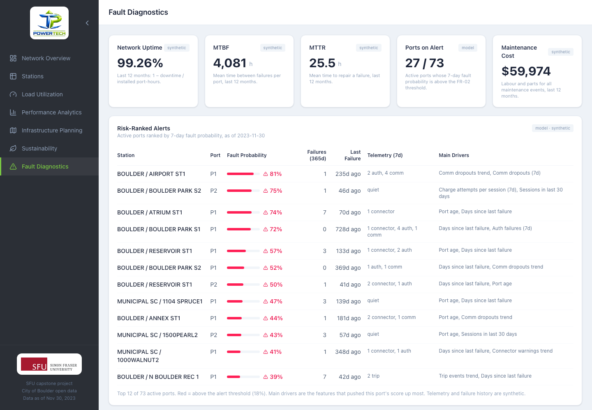

# PowerTech EV Charging Operations Dashboard

An operations dashboard for a municipal EV charging network. Built as an SFU
capstone project for **PowerTech**, using **real open data** from the City of
Boulder (Colorado). It turns raw charging session records into network KPIs,
per-station analytics, load/utilization insights, and financial performance
views.

## Live demo

**https://power-tech-dashboard.vercel.app**



| Infrastructure Planning | Fault Diagnostics |
| --- | --- |
|  |  |

## Tech stack

| Area | Technology |
| --- | --- |
| Framework | [React 19](https://react.dev/) + [TypeScript](https://www.typescriptlang.org/) |
| Build tool | [Vite 6](https://vite.dev/) |
| Styling | [Tailwind CSS 4](https://tailwindcss.com/) |
| Routing | [React Router 7](https://reactrouter.com/) |
| Data fetching | [TanStack Query 5](https://tanstack.com/query) |
| Charts / map | [Recharts](https://recharts.org/), [Leaflet](https://leafletjs.com/) via react-leaflet |
| Data export | Python (pandas, LightGBM, scikit-learn), see `scripts/requirements.txt` |
| CI | GitHub Actions: lint, type-check and build on every push and PR to `develop` / `main` |
| Hosting | [Vercel](https://vercel.com/) (auto-deploy on push to `main`) |

## Prerequisites

- **Node.js ≥ 20** (LTS recommended)
- **npm** (ships with Node)
- **Python ≥ 3.9**, only to re-export the data files (see [Data pipeline](#data-pipeline))

## Getting started

```bash
# 1. Install dependencies
npm install

# 2. Start the dev server (hot reload)
npm run dev
```

The app runs at **http://localhost:5173**.

To preview a production build locally:

```bash
npm run build
npm run preview
```

## NPM scripts

| Script | What it does |
| --- | --- |
| `npm run dev` | Start the Vite dev server with hot-module reload. |
| `npm run build` | Type-check (`tsc -b`) and produce an optimized build in `dist/`. |
| `npm run preview` | Serve the built `dist/` locally to sanity-check the production bundle. |
| `npm run lint` | Run ESLint over the project. |

## Project structure

```
power-tech/
├── .github/workflows/    # CI: lint, type-check, build
├── docs/screenshots/     # Images used in this README
├── public/               # Static assets (logos, favicon)
├── scripts/              # Python exporters: team workbook -> src/data/*.json
│   ├── export_dashboard_json.py
│   ├── export_ops_json.py
│   └── requirements.txt
├── src/
│   ├── pages/            # One component per route (Network Overview, Stations, …)
│   ├── components/       # Reusable UI (cards, charts, map, KPI tiles)
│   ├── layout/           # App shell: Sidebar, Header, DashboardLayout
│   ├── lib/              # Hooks, contexts, formatting, nav config
│   │   ├── queries.ts        # TanStack Query hooks
│   │   ├── city-context.tsx  # Active-city state
│   │   └── filter-context.tsx# Time-range filter state
│   ├── services/         # Data access layer
│   │   ├── api.ts            # Sessions, energy, revenue (boulder-data.json)
│   │   ├── mock-data.ts      # Station aggregates behind api.ts
│   │   └── ops.ts            # Ports, reliability, faults, planning (boulder-ops.json)
│   ├── data/             # Baked static datasets
│   │   ├── boulder-data.json # Real sessions, aggregated
│   │   └── boulder-ops.json  # Operations data, partly synthetic
│   ├── types/            # Shared TypeScript types
│   ├── App.tsx           # Route definitions
│   └── main.tsx          # App entry point
├── index.html
└── vite.config.ts
```

**Service-layer boundary.** Pages never import JSON directly. They read through
`src/services/api.ts` (session data) and `src/services/ops.ts` (operations
data), via the TanStack Query hooks in `src/lib/queries.ts`. A real backend API
can later replace the static JSON without changes to page code.
`boulder-ops.json` loads lazily, so only the last three pages download it.

## Data pipeline

The dashboard ships with **real charging data baked into static JSON** so it
loads instantly and deploys as a pure static site (no backend required).

Both data files are exported from the team workbook
`PowerTech_synthetic_dataset.xlsx` (kept outside the repo):

- `src/data/boulder-data.json` — real Boulder sessions de-duplicated and
  aggregated per station, per ZIP and per hour (energy, CO₂, revenue, etc.),
  with renamed chargers counted once under their current name. Written by
  `scripts/export_dashboard_json.py`.
- `src/data/boulder-ops.json` — ports, maintenance events, monthly reliability,
  FR-02 fault probabilities, sustainability roll-ups and planning metrics for the
  last three pages. Written by `scripts/export_ops_json.py`, which also needs
  `power_profile_15min.csv.gz` from beside the workbook.

```bash
pip install -r scripts/requirements.txt
python scripts/export_dashboard_json.py PowerTech_synthetic_dataset.xlsx src/data/boulder-data.json
python scripts/export_ops_json.py PowerTech_synthetic_dataset.xlsx power_profile_15min.csv.gz
```

On macOS, LightGBM needs `libomp` (`brew install libomp`).

**Data source & honesty notes**

- Source: City of Boulder open data.
- Revenue is an **estimate** computed from the city's real published L2 time
  tariff applied to real session durations.
- Port ratings, install dates, maintenance events, telemetry and failed visits
  are **synthetic** (generated by the team, see the workbook's data dictionary).
  Every card built on them carries a "synthetic" badge; model and forecast
  outputs carry "model" / "forecast".

## Features

- **Network Overview** — an **"Over time"** section whose range selector
  (30 / 90 days / 12 months) drives the windowed KPIs (sessions, energy, CO₂
  avoided, gasoline saved, charging efficiency) and an energy trend; plus
  all-time views: top stations per area, energy by ZIP, charger-type mix (with
  station count), and a station map. Two reliability cards summarise the last
  12 months: network uptime with the lowest-uptime stations, and the top faults
  with the ports most likely to fail next (detail on Fault Diagnostics).
- **Stations** — searchable, sortable, paginated table of every station with CSV
  export; click a row to drill into that station on Load Utilization.
- **Load Utilization** — hourly demand heatmap, per-station hourly energy (up to
  5 stations), an idle-blocking leaderboard (lowest charging efficiency), a
  48-hour demand forecast, load optimization, and an expansion recommendation.
- **Performance Analytics** — financial KPIs (total revenue, avg revenue per
  session, electricity cost); an **"Over time"** section with energy and
  charging-session (adoption) trends; site comparison; a utilization heatmap; and
  a weekday-vs-weekend hourly profile.
- **Infrastructure Planning** — installed capacity vs network peak load, a
  station action matrix that plots each station's Reliability Index (Ri: uptime,
  first-attempt success, failures, maintenance cost) against its Demand Pressure
  Index (Di: sessions per port, dwell, occupancy, time with every port busy),
  split at 50 into Expand / Refurbish / Decommission / Retain, with filters for
  inactive stations and public vs fleet; a 6-month demand forecast; and ports to
  add at Expand stations. Weights and scoring anchors are constants at the top
  of `scripts/export_ops_json.py`.
- **Sustainability** — energy delivered and CO₂ avoided per year, a CO₂ offset
  estimate (EPA equivalencies), an ESG summary, and ageing-asset flags.
- **Fault Diagnostics** — uptime, MTBF, MTTR and maintenance cost; a risk-ranked
  alert table from the FR-02 fault model; the model's probability distribution
  and test scores; fault history by repair category; MTBF and MTTR trends.

> Widgets that respond to a time control are grouped in a bounded **"Over time"**
> section; everything outside it is all-time (per-station data has no per-day
> breakdown to window).

## Deployment

Hosted on **Vercel**. Every push to the `main` branch triggers an automatic
production deployment. Client-side routing is handled by the SPA rewrite in
`vercel.json`, which serves `index.html` for all paths so deep links (e.g.
`/stations`) resolve correctly.

To build the deployable bundle manually:

```bash
npm run build   # outputs to dist/
```
